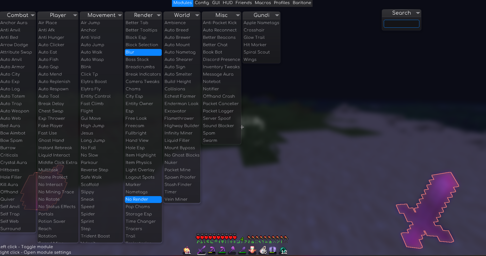
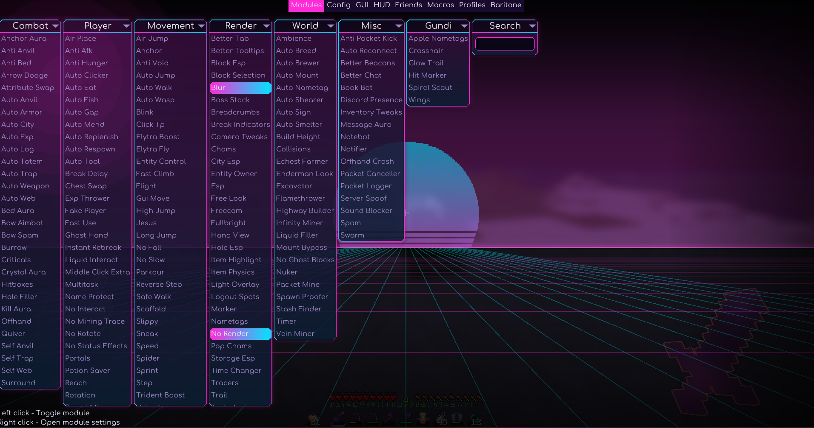
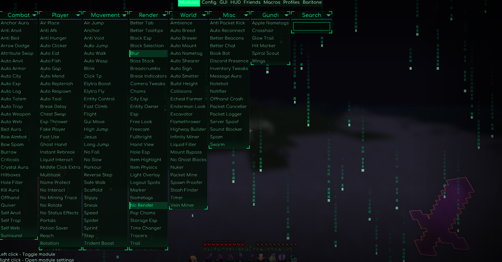
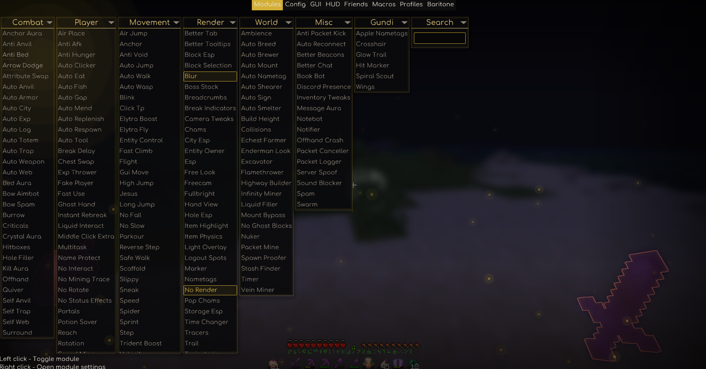
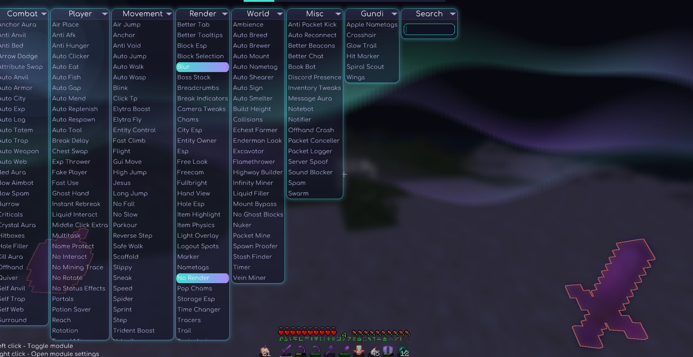
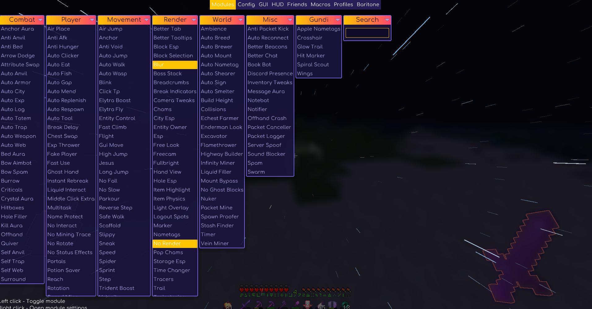
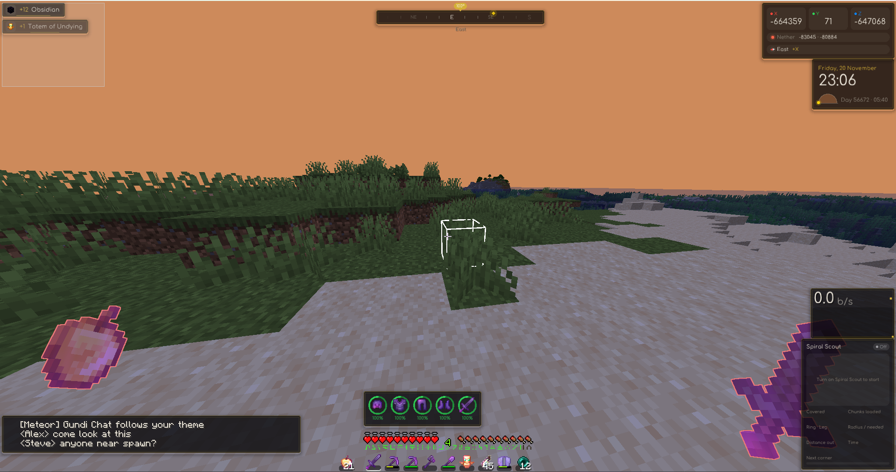

# Gundi

**For Minecraft 1.21.11** · requires [Meteor Client](https://meteorclient.com)

Gundi adds clean glass HUD elements, six GUI themes, a themed chat window, nametags, a custom crosshair and cosmetics.

> [!NOTE]
> **Made with AI.** The code of this addon was written by AI ([Claude Code](https://claude.com/claude-code)), not by me. I came up with the ideas, tested everything in game and decided what goes in.

## Download

1. Install [Fabric](https://fabricmc.net/use/installer/) for Minecraft **1.21.11**.
2. Put [Meteor Client](https://meteorclient.com) (1.21.11 build) in your `mods` folder.
3. Download the latest `gundi-*.jar` from the [Releases](../../releases) page and put it in the same `mods` folder.
4. Start the game. Gundi's modules are in the **Gundi** category, and its HUD elements are in the **Gundi** group of Meteor's HUD editor.

## Features

### GUI themes
Six full Meteor GUI themes: **Apple, Neon, Terminal, Noir, Aurora and Arcade**. They include a theme gallery and Spotlight-style search. HUD elements and modules can follow the selected theme automatically.

| Apple | Neon |
| --- | --- |
|  |  |
| **Terminal** | **Noir** |
|  |  |
| **Aurora** | **Arcade** |
|  |  |

### HUD elements
Every HUD element **changes with the theme**: pick a different GUI theme and the panels, colors and accents of your whole HUD switch to match it. Each element can also be set to its own colors instead.



| Element | What it does |
| --- | --- |
| Gundi Chat | A chat window that matches your theme. It has tabs (All, Players, Whispers, System), player heads, stacked repeats, mention pings, keyword highlights and right-click to copy. |
| Dynamic Island | An iPhone-style pill that shows module toggles. |
| Glass Coords | Coordinates with Nether/Overworld conversion. |
| Glass Clock | Real-time clock with a Minecraft day/night arc. |
| Compass Bar | Compass strip with player and death markers. |
| Radar | Circular radar with players, chests and directions. |
| Speed Graph | Your speed with a live graph. |
| Armor Rings | Armor durability as Apple Watch-style rings. |
| Pickup Feed | Notification cards for items entering your inventory. |
| Area Titles | Cinematic title when you enter a new biome or dimension. |
| Spiral Scout | Progress panel for the Spiral Scout module. |

### Modules
| Module | What it does |
| --- | --- |
| Apple Nametags | Nametags with head, health, gear and enchants. |
| Crosshair | Custom crosshair with many shapes, theme colors, movement spread and hit feedback. |
| Hit Marker | Shooter-style hit marker on your crosshair. |
| Spiral Scout | Flies an endless square spiral with ElytraFly to load a big area and find bases. Saves progress. |
| Wings | Cosmetic angel wings (only visible to you). |
| Glow Trail | A soft glowing ribbon that follows behind you (only visible to you). |

### Wings in action
▶ **[Watch the Wings video](docs/media/wings.mp4)**

## Building from source

Requires JDK 21 or newer.

```bash
./gradlew build
```

The jar is written to `build/libs/`. To test in a dev client, run `./gradlew runClient`.

## Credits

- Shout-out to **Jeff Mod** for the inspiration behind Spiral Scout.
- Built on [Meteor Client](https://meteorclient.com) and [Fabric](https://fabricmc.net).

## License

[GPL-3.0](LICENSE)
